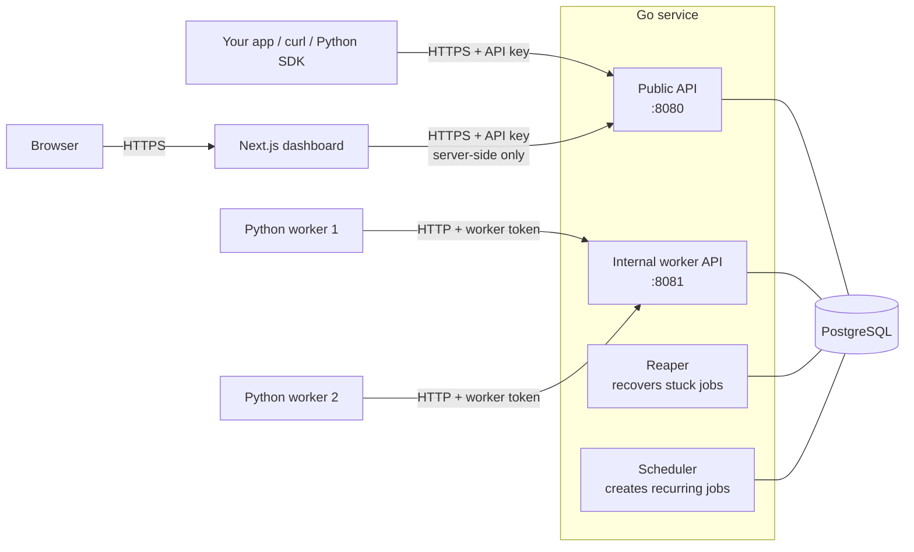
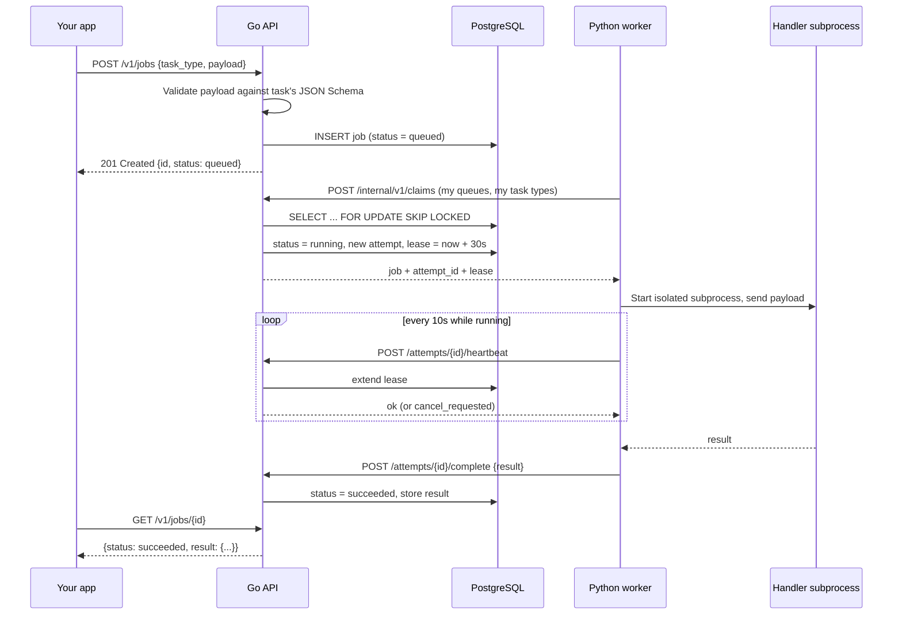
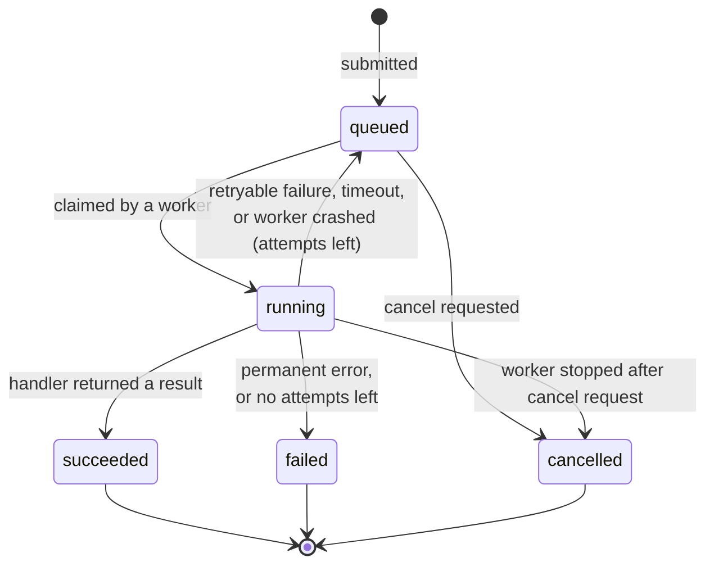

# TaskPilot

**A distributed background-job queue and scheduler, built with Go, Python and PostgreSQL.**

TaskPilot lets an application hand off slow work (reports, data processing, emails, exports) to background workers instead of doing it inside a web request. You submit a job over a REST API, a worker picks it up and runs it, and you can track, retry or cancel it at any time from the API, a Python SDK or a live dashboard.

If you have used **Celery** and **Celery Beat**, TaskPilot fills the same role. The difference is that it needs no Redis or RabbitMQ: PostgreSQL is the queue and the single source of truth.


---

## 📑 Table of contents

1. [🤔 Why TaskPilot?](#-why-taskpilot)
2. [✨ Features](#-features)
3. [🧰 Tech stack](#-tech-stack)
4. [🏗️ Architecture](#-architecture)
5. [🔄 How a job runs, step by step](#-how-a-job-runs-step-by-step)
6. [🚦 Job lifecycle](#-job-lifecycle)
7. [🛡️ How TaskPilot stays reliable](#-how-taskpilot-stays-reliable)
8. [⏰ Scheduled (recurring) jobs](#-scheduled-recurring-jobs)
9. [🔐 Security](#-security)
10. [📁 Project structure](#-project-structure)
11. [🚀 Getting started](#-getting-started)
12. [🌐 Using the REST API](#-using-the-rest-api)
13. [🐍 Using the Python SDK](#-using-the-python-sdk)
14. [📊 The dashboard](#-the-dashboard)
15. [⚙️ Configuration](#-configuration)
16. [🧪 Running the tests](#-running-the-tests)
17. [🗄️ Database schema](#-database-schema)
18. [🗺️ Project status and roadmap](#-project-status-and-roadmap)
19. [👤 Author](#-author)

---

## 🤔 Why TaskPilot?

Web requests should be fast. Some work is not: generating a PDF report over 100K rows, crunching analytics, calling a slow third-party API. Doing that inside the request makes users wait and ties up the server.

The usual answer is a **job queue**:

1. The web app says *"please run `generate_report` with these inputs"* and returns immediately.
2. A separate **worker** process picks up that job and runs it in the background.
3. The app (or the user) checks back later for the result.

Tools like Celery do this well but need a separate message broker (Redis or RabbitMQ). TaskPilot shows that **PostgreSQL alone** can do the job safely, using row locks, leases and transactions, which means one less system to run and every job's state is queryable with plain SQL.

## ✨ Features

| Feature | What it means |
|---|---|
| **REST API** | Submit, list, inspect, and cancel jobs over a versioned `/v1` HTTP API (OpenAPI 3 spec included). |
| **Python task SDK** | Define a task with a `@registry.task(...)` decorator. Its payload schema is generated automatically and every submitted payload is validated against it. |
| **Producer client** | Submit and wait for jobs from your Python app, the replacement for Celery's `.delay()`. |
| **Named queues** | Route tasks to queues (`default`, `analytics`, …) and run workers that serve only some queues. |
| **Automatic retries** | Failed jobs retry with **exponential backoff and jitter**, up to a configurable number of attempts. |
| **Timeouts** | Every job has a time limit. A job that runs too long is stopped and retried. |
| **Crash recovery** | If a worker dies mid-job, its **lease** expires and the job is picked up again automatically. |
| **Cancellation** | Cancel a queued job instantly, or ask a running job to stop. |
| **Delayed jobs** | Submit a job to run at a future time with `run_at`. |
| **Idempotency keys** | Send the same request twice with an `Idempotency-Key` header and you get the original job back, not a duplicate. |
| **Scheduled jobs** | Run jobs on a **cron expression** or a fixed interval, the replacement for Celery Beat. |
| **Multi-tenant** | Every API key belongs to a tenant, and a tenant can only ever see its own jobs. |
| **Live dashboard** | A Next.js dashboard with queue depth, throughput, worker status, a task catalogue, and per-job details. |

## 🧰 Tech stack

| Layer | Technology | Why |
|---|---|---|
| API and orchestrator | **Go** (standard-library `net/http`, `pgx`) | Fast, simple concurrency, single static binary. |
| Database and queue | **PostgreSQL 16** | Durable job state, row-level locking (`SKIP LOCKED`), transactions. |
| Migrations | **goose** | Versioned SQL migrations embedded in the Go binary. |
| Schedules | **robfig/cron** | Standard 5-field cron expressions with time zones. |
| Payload validation | **JSON Schema** | Go validates every payload against the schema the task registered. |
| Worker | **Python 3.10+**, `asyncio`, `httpx`, `pydantic` | Where most real task code (data, reports, ML) already lives. |
| Python tooling | **uv**, **ruff**, **mypy --strict**, **pytest** | Locked dependencies, linting, strict typing, tests. |
| Dashboard | **Next.js 16**, **React 19**, **TypeScript**, **Tailwind CSS 4** | Server-rendered dashboard; types generated from the OpenAPI spec. |
| Local infrastructure | **Docker Compose** | One command to start PostgreSQL. |

## 🏗️ Architecture



There are four parts:

1. **Go service (`taskpilot-api`)** is the brain. It runs two HTTP listeners:
   - the **public API** on port `8080`, used by clients and the dashboard (authenticated with tenant API keys);
   - the **internal worker API** on port `8081`, used only by workers (authenticated with a shared worker token, never exposed to the internet).

   It also runs two background loops: the **reaper**, which finds jobs whose worker went silent or ran past the deadline, and the **scheduler**, which turns due schedules into jobs.
2. **PostgreSQL** stores everything: tenants, API keys, jobs, attempts, task types, workers, schedules and an audit log.
3. **Python workers** run your task code. They **do not have database credentials.** They ask Go for work, run it, and report the result back over HTTP. Go is the only component that ever changes job state, which keeps the rules in one place.
4. **Next.js dashboard** is what a person uses in the browser. The browser only talks to Next.js; Next.js calls the Go API from the server, so the API key never reaches browser JavaScript.

## 🔄 How a job runs, step by step



1. **Submit.** Your app sends the task type and a JSON payload. Go checks the payload against the schema the worker registered for that task, then saves the job as `queued`.
2. **Claim.** An idle worker asks for work. Go picks the oldest ready job using `FOR UPDATE SKIP LOCKED`, so two workers can never grab the same job. It creates an **attempt** and gives the worker a **lease** (default 30 seconds).
3. **Run.** The worker runs the handler in a **separate subprocess**. If the handler crashes or leaks memory, only that subprocess dies, not the worker.
4. **Heartbeat.** While the job runs, the worker sends a heartbeat every 10 seconds to extend the lease. The heartbeat reply also tells the worker if someone asked to cancel the job.
5. **Report.** The worker reports `complete`, `fail` (with a retryable or permanent error), or `cancelled`. Go updates the job in one transaction.
6. **Read.** Your app polls `GET /v1/jobs/{id}` (or the SDK's `wait()`) and reads the result.

## 🚦 Job lifecycle

Every job is in exactly one of five states:



| State | Meaning |
|---|---|
| `queued` | Waiting for a worker (or waiting until its retry / `run_at` time). |
| `running` | A worker holds a lease on it and is executing it. |
| `succeeded` | Finished; the result is stored. |
| `failed` | Gave up. `failure_reason` is `permanent_error` or `max_attempts_exceeded`. |
| `cancelled` | Stopped at the client's request. |

Each run of a job is recorded as an **attempt**, so you can see the full history of a job: when each try started, how it ended (`succeeded`, `failed`, `timed_out`, `lease_expired`, `cancelled`) and the error it hit.

### Retry backoff

When an attempt fails with a retryable error, times out, or loses its worker, the job goes back to `queued` with a delay:

```
delay = random(0, min(RETRY_CAP, RETRY_BASE × 2^(attempt − 1)))     (at least 1 second)
```

With the defaults (`RETRY_BASE = 5s`, `RETRY_CAP = 10m`) the upper limit grows 5s → 10s → 20s → 40s … up to 10 minutes. The random part (**full jitter**) spreads retries out so a failing downstream service is not hit by every job at the same moment.

## 🛡️ How TaskPilot stays reliable

**Safe concurrent claiming.** Workers claim jobs with `SELECT … FOR UPDATE SKIP LOCKED`. A row locked by one worker's transaction is simply skipped by the others, so many workers can poll at once without blocking or double-claiming.

**Leases and heartbeats.** A claimed job has a `lease_expires_at` time. The worker keeps extending it with heartbeats. If a worker crashes, loses network or freezes, the heartbeats stop and the lease runs out.

**The reaper.** Every 15 seconds the Go service looks for running jobs whose lease has expired or whose deadline has passed, ends that attempt (`lease_expired` or `timed_out`) and requeues the job with backoff, or fails it if no attempts are left.

**Fencing.** Every report from a worker names its `attempt_id`, and Go only accepts it if that attempt is still the job's *current* attempt. A slow worker that comes back after its lease expired cannot overwrite the result of a newer attempt.

**Worker self-fencing.** If a worker cannot reach the API to renew its lease, it stops the handler before the lease runs out instead of carrying on as a "zombie".

**Graceful shutdown.** On shutdown the API stops reporting ready, finishes in-flight requests, then exits. Workers stop claiming, let running jobs finish within a grace period, and report the rest.

**At-least-once delivery.** These rules guarantee a job is never lost, but in rare cases (for example a worker crashes just after its handler finished) a job can run more than once. TaskPilot does **not** promise exactly-once. Handlers should be idempotent; the handler context gives you the stable `job_id` to use as an idempotency key for external calls.

## ⏰ Scheduled (recurring) jobs

Schedules replace Celery Beat. A schedule says *"submit this task with this payload"* on either:

- a **cron expression** (5 fields, e.g. `0 18 * * *` = every day at 18:00), evaluated in a time zone you choose, or
- a fixed **interval** in seconds (5 seconds to 1 year).

How it works:

- Every API replica checks for due schedules every second, using `FOR UPDATE SKIP LOCKED` on the schedules table. You can run several API replicas and each due run is still created **exactly once**.
- By default a run is **skipped while the previous job from the same schedule is still queued or running**. Set `allow_overlap: true` to change that.
- Runs missed while no API was running are skipped, not replayed in a burst.
- `PUT /v1/schedules/{name}` is an upsert. Sending an unchanged schedule keeps its next run time, so it is safe to call on every deploy.

## 🔐 Security

- **API keys** are random secrets shown once when created. Only a SHA-256 hash is stored in the database.
- **Scopes.** Each key has scopes (`jobs:read`, `jobs:write`, `jobs:cancel`) checked on every endpoint.
- **Tenant isolation.** Every query filters by the `tenant_id` of the authenticated key. A tenant id is never read from the request body, query string, or URL.
- **No arbitrary code execution.** Workers only run task types that are explicitly registered in code. There is no endpoint that runs shell commands, scripts, or uploaded code.
- **Isolated handlers.** Each job runs in a subprocess started with a fixed command (no shell) and Python's isolated mode. Environment variables are passed through only if explicitly allowed; the worker token never is.
- **Least-privilege database role.** The API connects as `taskpilot_app`, which can read and write rows but cannot change the schema. Migrations run with a separate owner role. The app role also has a `statement_timeout`.
- **Workers have no database access.** A compromised worker cannot read other tenants' data from the database.
- **Browser never sees the API key.** The dashboard keeps the key in an encrypted, HTTP-only session cookie and calls the API from the server.
- **Errors** follow RFC 9457 (`application/problem+json`) with stable error codes. Payloads, results and secrets are never logged.

## 📁 Project structure

```
TaskPilot/
├── backend/
│   ├── api/
│   │   └── openapi.yaml              # HTTP contract for the public and internal APIs
│   ├── contracts/
│   │   └── job.schema.json           # JSON Schema of the job message shared by Go and Python
│   ├── deploy/postgres/init.sql      # Creates the least-privilege app role for local Postgres
│   ├── compose.yaml                  # Local PostgreSQL
│   ├── .env.example                  # Every backend setting, with safe local placeholders
│   ├── server/                       # Go module
│   │   ├── cmd/
│   │   │   ├── taskpilot-api/        # The API server (public + worker listeners, reaper, scheduler)
│   │   │   └── taskpilot-admin/      # Admin CLI: migrations, tenants, API keys, task types
│   │   ├── internal/
│   │   │   ├── auth/                 # API key hashing, scopes, worker token check
│   │   │   ├── config/               # Environment-variable configuration with validation
│   │   │   ├── httpapi/              # HTTP handlers: decode → validate → call domain → encode
│   │   │   ├── jobs/                 # Core logic: submit, claim, heartbeat, finish, retry, schedules, stats
│   │   │   ├── reaper/               # Background loop for expired leases and timeouts
│   │   │   ├── store/                # PostgreSQL connection pool and migrations
│   │   │   └── tasktypes/            # Task-type registry and JSON Schema validation
│   │   └── migrations/               # Versioned SQL migrations (embedded into the binary)
│   └── worker/                       # Python package `taskpilot_worker`
│       ├── src/taskpilot_worker/
│       │   ├── registry.py           # @registry.task decorator and payload models
│       │   ├── supervisor.py         # Claim loop, heartbeats, timeouts, cancellation, shutdown
│       │   ├── child.py              # Runs one handler inside an isolated subprocess
│       │   ├── client.py             # HTTP client for the internal worker API
│       │   ├── producer.py           # Public-API client: submit, wait, cancel, schedules
│       │   └── handlers/             # Built-in demo tasks
│       └── tests/
└── frontend/                         # Next.js dashboard (deployed separately, e.g. on Vercel)
    └── src/
        ├── app/                      # Pages: dashboard, jobs list, job detail, login
        ├── components/dashboard/     # Metrics, queues, pipeline, throughput chart, task catalogue
        └── lib/                      # API client (typed from OpenAPI), session handling
```

`backend/` and `frontend/` are independent services. Each has its own dependencies, configuration, and build. The frontend only depends on the backend through the OpenAPI contract.

## 🚀 Getting started

### Prerequisites

| Tool | Version |
|---|---|
| Go | 1.27+ |
| Python | 3.10+ for the worker SDK (3.12 used for development) |
| [uv](https://docs.astral.sh/uv/) | Latest, for Python dependencies |
| Node.js | 22+ |
| Docker with Compose v2 | For the local PostgreSQL |

The commands below are for a Bash shell (Linux, macOS, or Git Bash on Windows).

### 1. Start PostgreSQL

```bash
cd backend
cp .env.example .env                  # local placeholders only; edit POSTGRES_PORT and both DB URLs if 5432 is taken
docker compose up -d --wait postgres
set -a; . ./.env; set +a              # export the settings into this shell
```

### 2. Build, migrate, and create an API key

```bash
cd server
go build -o bin/ ./cmd/...

./bin/taskpilot-admin migrate up                                   # create the tables
./bin/taskpilot-admin tenant create -name demo                     # prints the tenant id
./bin/taskpilot-admin key create -tenant <tenant-id> -name me      # prints the API key ONCE — copy it
```

### 3. Run the API

```bash
./bin/taskpilot-api          # public API on :8080, worker API on :8081
```

### 4. Run a worker (second terminal)

```bash
cd backend/worker
uv sync
uv run --env-file ../.env python -m taskpilot_worker
```

On start, the worker registers its task types with the API. The built-in demo tasks are:

| Task type | What it does |
|---|---|
| `system.echo` | Returns your message unchanged. Quickest end-to-end check. |
| `text.word_count` | Counts words in a piece of text. |
| `data.csv_summary` | Summarises a small CSV: row count and per-column stats. |
| `system.sleep` | Test task: waits, then succeeds, fails, or crashes on purpose. Lets you watch retries and recovery. |

### 5. Submit a job (third terminal)

```bash
export KEY=<your-api-key>

curl -s -X POST localhost:8080/v1/jobs \
  -H "Authorization: Bearer $KEY" \
  -H "Content-Type: application/json" \
  -d '{"task_type":"text.word_count","task_version":1,"payload":{"text":"hello hello world"}}'

curl -s localhost:8080/v1/jobs/<job-id> -H "Authorization: Bearer $KEY"
```

### 6. Start the dashboard (fourth terminal)

```bash
cd frontend
cp .env.example .env.local
# set SESSION_SECRET in .env.local to 32 random bytes, for example:
#   node -e "console.log(require('crypto').randomBytes(32).toString('base64'))"
npm ci
npm run dev                  # http://localhost:3000 — sign in with your API key
```

### Admin CLI reference

| Command | Purpose |
|---|---|
| `taskpilot-admin migrate up` | Apply all pending migrations. |
| `taskpilot-admin migrate status` | Show which migrations are applied. |
| `taskpilot-admin tenant create -name <name>` | Create a tenant. |
| `taskpilot-admin key create -tenant <id> -name <name> [-scopes jobs:read,…]` | Create an API key (shown once). All scopes by default. |
| `taskpilot-admin key revoke -id <key-id>` | Revoke an API key. |
| `taskpilot-admin tasktype list` | List registered task types. |
| `taskpilot-admin tasktype retire -type <task-type>` | Stop accepting new jobs for a task type. |

## 🌐 Using the REST API

All public endpoints need `Authorization: Bearer <api-key>`. The full contract is in [`backend/api/openapi.yaml`](backend/api/openapi.yaml).

| Method | Path | Scope | Description |
|---|---|---|---|
| `POST` | `/v1/jobs` | `jobs:write` | Submit a job. Optional `Idempotency-Key` header. |
| `GET` | `/v1/jobs` | `jobs:read` | List your jobs. Filter by `status`, `task_type`, `queue`; cursor pagination. |
| `GET` | `/v1/jobs/{job_id}` | `jobs:read` | Get one job, including its result or error. |
| `GET` | `/v1/jobs/{job_id}/attempts` | `jobs:read` | Every attempt of a job. |
| `POST` | `/v1/jobs/{job_id}/cancel` | `jobs:cancel` | Cancel a job. |
| `GET` | `/v1/schedules` | `jobs:read` | List schedules. |
| `GET` | `/v1/schedules/{name}` | `jobs:read` | Get one schedule. |
| `PUT` | `/v1/schedules/{name}` | `jobs:write` | Create or update a schedule. |
| `DELETE` | `/v1/schedules/{name}` | `jobs:write` | Delete a schedule. |
| `GET` | `/v1/task-types` | `jobs:read` | Task catalogue with payload schemas and examples. |
| `GET` | `/v1/stats` | `jobs:read` | Counts per state, success rate, latency, throughput, queues, workers (powers the dashboard). |
| `GET` | `/v1/me` | any | Who this API key belongs to. |
| `GET` | `/healthz`, `/readyz` | none | Liveness and readiness probes. |

### Submit a job

```http
POST /v1/jobs
Authorization: Bearer <api-key>
Idempotency-Key: report-2026-10-14
Content-Type: application/json

{
  "task_type": "text.word_count",
  "task_version": 1,
  "payload": { "text": "hello hello world" },
  "queue": "default",
  "max_attempts": 3,
  "timeout_seconds": 60,
  "run_at": "2026-10-14T18:00:00Z"
}
```

Only `task_type`, `task_version` and `payload` are required. Everything else falls back to the task's defaults.

### Errors

Errors use the standard problem format:

```json
{
  "type": "https://taskpilot.dev/problems/invalid_payload",
  "title": "Validation failed",
  "status": 422,
  "code": "invalid_payload",
  "request_id": "…",
  "errors": [{ "field": "/text", "message": "…" }]
}
```

The `code` field is stable, so clients can switch on it (for example `invalid_payload`, `unknown_task_type`, `job_not_found`, `job_not_cancellable`, `idempotency_key_conflict`). The `request_id` matches the server log line for that request.

## 🐍 Using the Python SDK

### Define a task

```python
from typing import Any
from taskpilot_worker.registry import TaskRegistry, Payload, HandlerContext

registry = TaskRegistry()

class ComputeMetricsV1(Payload):
    usecase_id: str

@registry.task("analytics.compute_usecase_metrics", queue="analytics", timeout=600)
def compute(p: ComputeMetricsV1, ctx: HandlerContext) -> dict[str, Any]:
    # ctx.job_id stays the same across retries — use it as an idempotency key
    ...
    return {"rows": 1234}
```

- The **payload model** (a pydantic class) defines the input. Its JSON Schema is generated and registered with the API automatically, so bad payloads are rejected at submit time, before any worker sees them.
- Unknown fields are rejected and payloads are immutable.
- The handler returns a JSON-serialisable dict, which becomes the job's result.

Run a worker for your own tasks and queues:

```bash
TASKPILOT_WORKER_APP=yourapp.taskpilot_tasks:registry \
TASKPILOT_WORKER_QUEUES=analytics \
python -m taskpilot_worker
```

### Submit and wait (replaces Celery's `.delay()`)

```python
import os
from taskpilot_worker.producer import TaskPilot

with TaskPilot("http://localhost:8080", api_key=os.environ["TASKPILOT_API_KEY"]) as tp:
    job = tp.submit(
        "analytics.compute_usecase_metrics",
        {"usecase_id": "u1"},
        idempotency_key="u1-day-1",   # safe to retry this call
        delay_seconds=30,             # optional: run later
    )
    done = tp.wait(job["id"], timeout=120)
    print(done["status"], done.get("result"))
```

Other methods: `get(job_id)`, `cancel(job_id)`.

### Create a schedule (replaces Celery Beat)

```python
tp.put_schedule(
    "daily-metrics",
    "analytics.compute_usecase_metrics",
    {"usecase_id": "u1"},
    cron="0 18 * * *",      # or every_seconds=300
    tz="Asia/Kolkata",
)
tp.list_schedules()
tp.delete_schedule("daily-metrics")
```

## 📊 The dashboard

The Next.js dashboard is a separate app you sign in to with an API key. It shows:

- **Live metrics:** jobs by state, success rate, retries, p50/p95 latency, and a throughput chart.
- **Queues:** ready, delayed and running jobs per queue, queue lag (how long the oldest ready job has waited), and online worker slots.
- **Workers:** which workers are online and which queues they serve.
- **Pipeline view:** how jobs move through queued → running → finished, with an inspector for each stage.
- **Task catalogue:** every registered task type, its payload fields, and an example.
- **Submit panel:** submit a job from the browser with a payload pre-filled from the example.
- **Jobs list and job detail:** status, payload, result or error, and every attempt, updating live while the job runs.

The browser only calls the Next.js server. The API key is stored in an encrypted HTTP-only cookie and never exposed to browser JavaScript. API types are generated from `openapi.yaml` (`npm run gen:api`), so the dashboard and API cannot silently drift apart.

## ⚙️ Configuration

All settings are environment variables. [`backend/.env.example`](backend/.env.example) and [`frontend/.env.example`](frontend/.env.example) list every one with safe local placeholders. The most important:

| Variable | Default | Purpose |
|---|---|---|
| `DATABASE_URL` | — | App-role connection used by the API. |
| `TASKPILOT_MIGRATE_DATABASE_URL` | — | Owner-role connection used for migrations. |
| `TASKPILOT_WORKER_TOKEN` | — | Shared secret between API and workers (≥ 32 random bytes in real environments). |
| `TASKPILOT_HTTP_ADDR` | `:8080` | Public API address. |
| `TASKPILOT_WORKER_API_ADDR` | `:8081` | Internal worker API address. Keep it private. |
| `TASKPILOT_LEASE_DURATION` | `30s` | How long a claim lasts without a heartbeat. |
| `TASKPILOT_HEARTBEAT_INTERVAL` | `10s` | How often workers renew. Must be shorter than the lease. |
| `TASKPILOT_REAPER_INTERVAL` | `15s` | How often expired leases and timeouts are checked. |
| `TASKPILOT_SCHEDULER_INTERVAL` | `1s` | How often due schedules are checked. |
| `TASKPILOT_RETRY_BASE` / `TASKPILOT_RETRY_CAP` | `5s` / `10m` | Backoff starting delay and maximum. |
| `TASKPILOT_DEFAULT_MAX_ATTEMPTS` | `3` | Attempts per job unless the job says otherwise. |
| `TASKPILOT_IDEMPOTENCY_TTL` | `24h` | How long an idempotency key is remembered. |
| `TASKPILOT_ENABLE_TEST_TASKS` | `false` | Allow test-only tasks such as `system.sleep`. |
| `TASKPILOT_API_INTERNAL_URL` | — | Where workers reach the worker API. |
| `TASKPILOT_WORKER_CONCURRENCY` | `4` | Jobs one worker runs at the same time. |
| `TASKPILOT_WORKER_APP` | built-in demo tasks | `module:attribute` of the `TaskRegistry` to run. |
| `TASKPILOT_WORKER_QUEUES` | all queues of the app's tasks | Comma-separated queues this worker serves. |
| `TASKPILOT_API_BASE_URL` (frontend) | — | Go API URL used by the Next.js server. |
| `SESSION_SECRET` (frontend) | — | 32 random bytes for encrypting the session cookie. |

The API validates its configuration at startup and refuses to start with a clear error if something is missing or inconsistent.

## 🧪 Running the tests

```bash
# Go: formatting, vet, unit tests
cd backend/server
gofmt -l . && go vet ./... && go test -shuffle=on ./...

# Go: integration tests against a real PostgreSQL
TASKPILOT_TEST_DATABASE_URL=$TASKPILOT_MIGRATE_DATABASE_URL go test -tags=integration ./internal/jobs/

# Python worker: format, lint, strict typing, tests
cd ../worker
uv run ruff format --check . && uv run ruff check . && uv run mypy --strict src tests && uv run pytest -q

# Frontend: typecheck, lint, unit tests, production build
cd ../../frontend
npm run check
```

What the tests cover:

- **State machine:** every retry, failure, cancel and backoff decision (`transitions_test.go`).
- **Integration with PostgreSQL:** submit and complete, payload validation, idempotency (including concurrent submits), many workers claiming at once, stale-attempt fencing, retry then give up, cancellation, deadline reaping, pagination, queue routing, worker presence, and schedules, all against a real database.
- **Worker:** subprocess runner, supervisor (timeouts, crashes, cancellation), registry and producer client.
- **Frontend:** payload handling, formatting, and session logic.

`go test -race` needs cgo with a 64-bit C compiler. On Windows, run it inside a `golang` Docker container.

## 🗄️ Database schema

| Table | Holds |
|---|---|
| `tenants` | Customers / organisations. |
| `api_keys` | Hashed API keys with scopes, one tenant each. |
| `jobs` | One row per job: status, payload, result, queue, attempts, lease, idempotency key, timings. |
| `job_attempts` | One row per execution attempt, with its outcome and error. |
| `task_types` | Task types registered by workers, with payload JSON Schema, queue and limits. |
| `workers` | Workers that have registered, and when they were last seen. |
| `schedules` | Recurring job definitions (cron or interval), next and last run. |
| `audit_events` | Audit trail of actions per tenant (for example schedule changes and scheduled job creation). |

Partial indexes keep the hot paths fast as the table grows, for example:

```sql
CREATE INDEX jobs_claim_idx ON jobs (queue, available_at, id) WHERE status = 'queued';
CREATE INDEX jobs_lease_idx ON jobs (lease_expires_at)        WHERE status = 'running';
```

The claim query only ever touches queued rows, and the reaper only touches running rows.

## 🗺️ Project status and roadmap

> 🟠 **Status: working prototype.** Everything in the "Built" list runs end to end against PostgreSQL and is covered by unit and integration tests. TaskPilot is **not production-ready yet**: the items in "Still to build" are what stands between this prototype and a production system.

### ✅ Built

| | Area | What works today |
|---|---|---|
| ✅ | **REST API** | Submit, list, inspect, and cancel jobs, with API keys, scopes, and tenant isolation. |
| ✅ | **Job engine** | Safe claiming with `SKIP LOCKED`, leases, heartbeats, fencing, retries with backoff, timeouts. |
| ✅ | **Crash recovery** | The reaper requeues jobs from dead or stuck workers. |
| ✅ | **Cancellation** | Instant for queued jobs; running jobs are stopped by their worker. |
| ✅ | **Idempotency** | Repeated submits with the same key return the original job. |
| ✅ | **Named queues** | Route tasks to queues and run workers per queue. |
| ✅ | **Scheduled jobs** | Cron and interval schedules, safe across several API replicas. |
| ✅ | **Python worker + SDK** | `@registry.task` decorator, auto-generated payload schemas, isolated subprocess per job, producer client. |
| ✅ | **Dashboard** | Live metrics, queues, workers, task catalogue, job submit, job details. |
| ✅ | **Tests** | Go unit and integration tests, Python tests with strict typing, frontend unit tests. |

### 🚧 Still to build

| | Item | Why it matters |
|---|---|---|
| 🚦 | **Rate limiting** on the public API | Stops one client from flooding the system with requests or jobs. The settings already exist in `.env.example`; the enforcement does not. |
| 📈 | **Prometheus metrics and tracing** | Lets operators graph queue depth, failures, and latency, and follow one job across Go and Python. Today the numbers are only visible in the dashboard and `/v1/stats`. |
| 🧹 | **Automatic cleanup of old jobs** | Finished jobs are kept forever right now, so the `jobs` table keeps growing. Retention settings exist but nothing deletes old rows yet. |
| 🐳 | **Dockerfiles** for the API and worker | Only PostgreSQL runs in Docker today. Images are needed to deploy the API and workers anywhere. |
| 🤖 | **CI pipeline** (GitHub Actions) | Runs the lint, type checks and tests automatically on every pull request instead of by hand. |
| 🎭 | **End-to-end browser tests** (Playwright) | Checks real user flows in the dashboard: sign in, submit a job, watch it finish. |
| ⚡ | **Load testing** | Measures how many jobs per second TaskPilot can handle. No performance numbers are claimed until this is done. |

## 👤 Author

**Alkesh Shukla** · [GitHub](https://github.com/shuklaAlkesh) · [LinkedIn](https://linkedin.com/in/alkesh-shukla)
