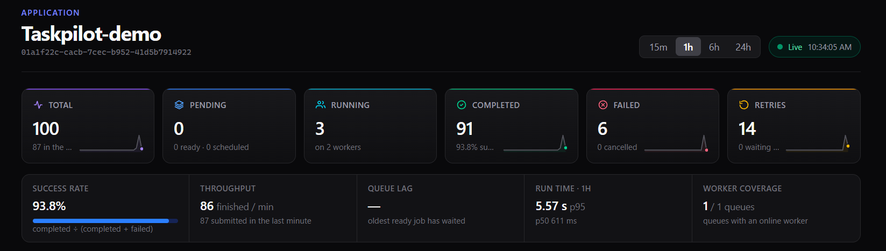
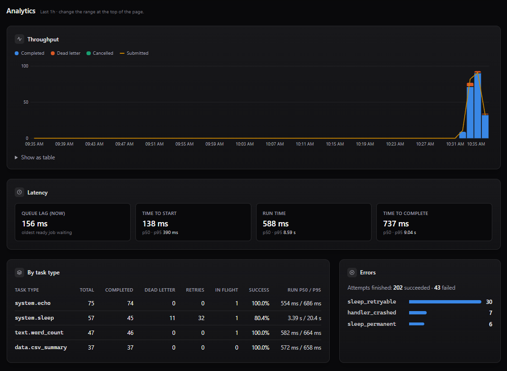
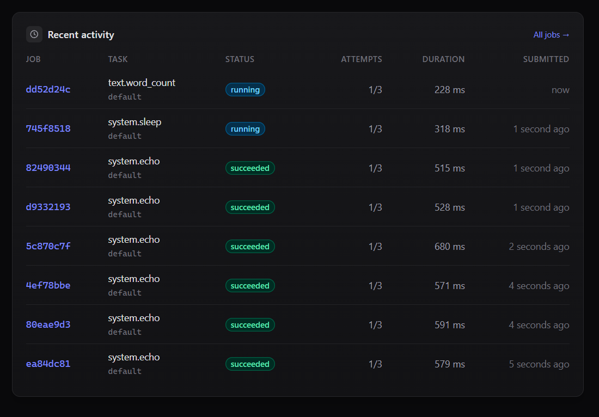
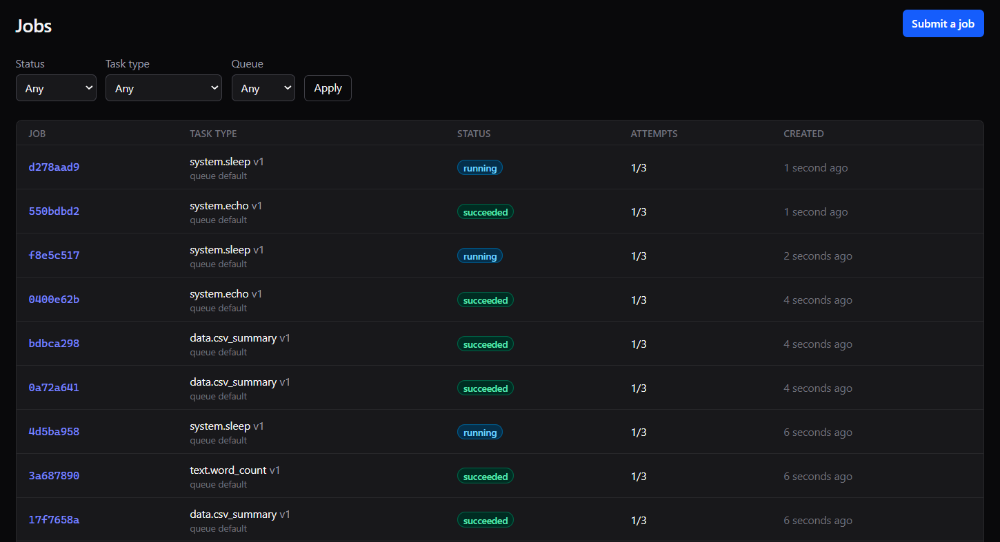
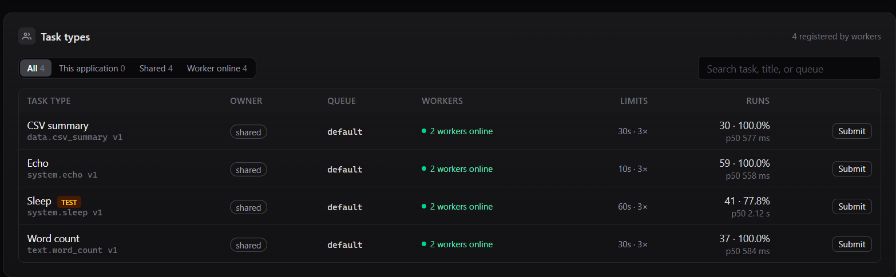
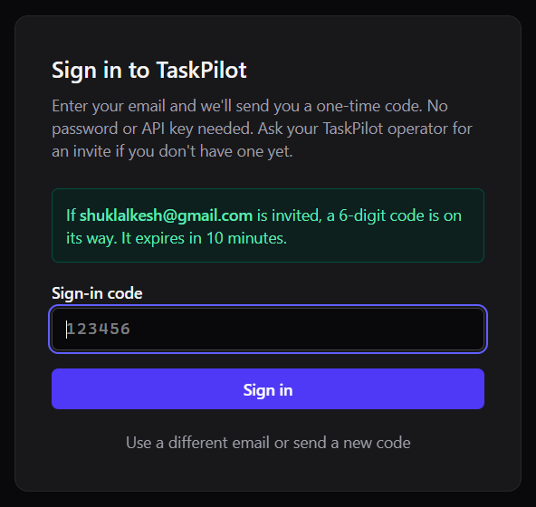
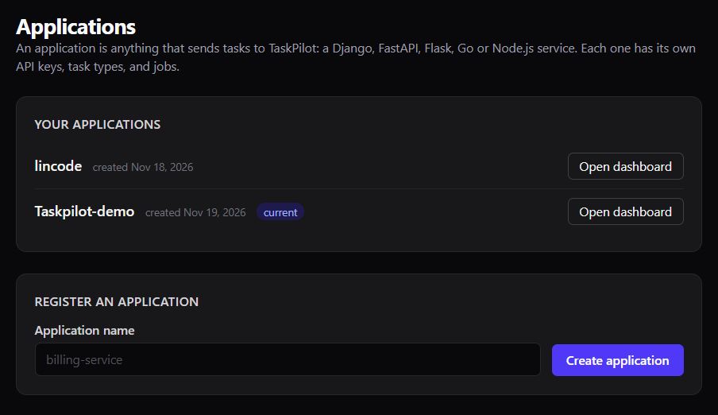
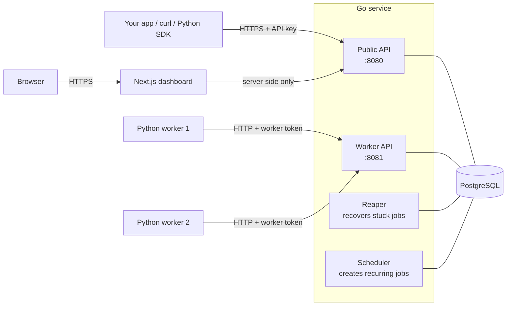
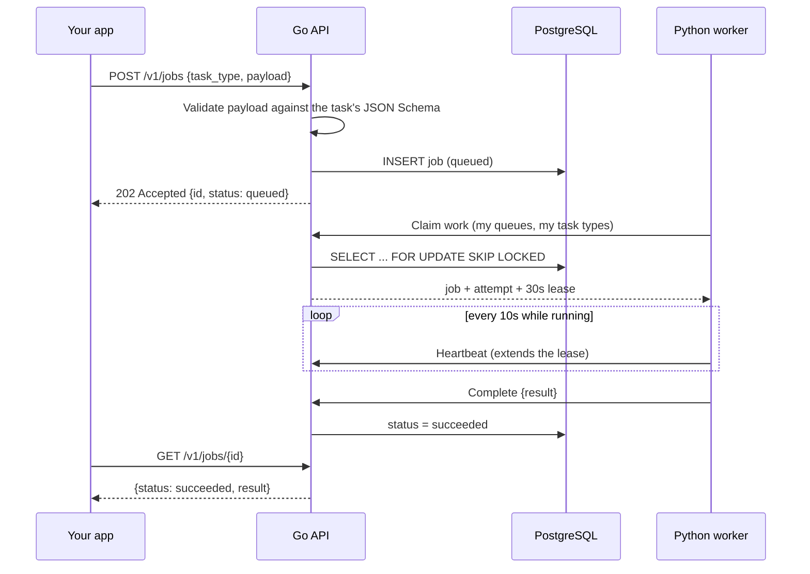
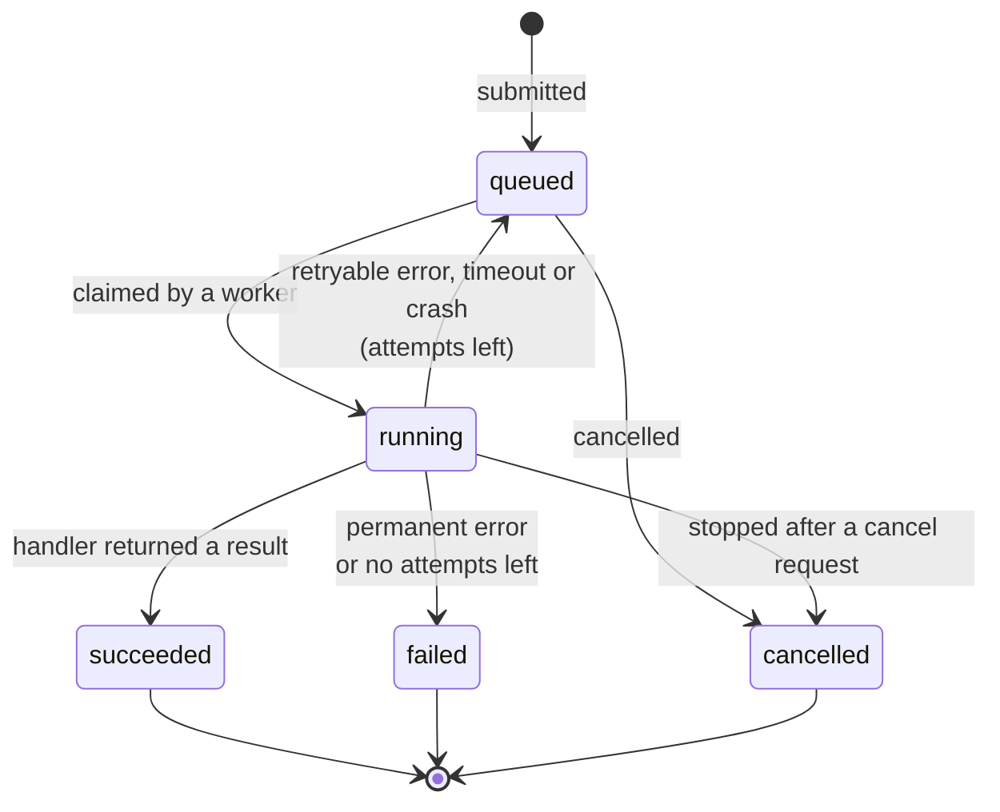

<div align="center">

# ✈️ TaskPilot

**A background-job queue and scheduler built with Go, Python and PostgreSQL.**

Send slow work to background workers, then track, retry, cancel and schedule it
from a REST API, a Python SDK or a live dashboard.




</div>

---

## 📑 Contents

1. [What is TaskPilot?](#-what-is-taskpilot)
2. [Screenshots](#-screenshots)
3. [Features](#-features)
4. [How it works](#-how-it-works)
5. [Getting started](#-getting-started)
6. [Using the REST API](#-using-the-rest-api)
7. [Using the Python SDK](#-using-the-python-sdk)
8. [Reliability](#-reliability)
9. [Security](#-security)
10. [Configuration](#-configuration)
11. [Running the tests](#-running-the-tests)
12. [Project structure](#-project-structure)
13. [Project status and what's left](#-project-status-and-whats-left)
14. [Author](#-author)

---

## 🤔 What is TaskPilot?

Web requests should be fast. Some work is not: building a report over 100,000 rows, processing a CSV,
calling a slow third-party API, sending a batch of emails. Doing that inside the request makes users wait.

A **job queue** fixes this:

1. Your app says *"run `generate_report` with these inputs"* and returns straight away.
2. A **worker** process picks up the job and runs it in the background.
3. Your app (or the user) checks back for the result.

If you know **Celery** and **Celery Beat**, TaskPilot does the same job, with one big difference:
**it needs no Redis or RabbitMQ.** PostgreSQL is the queue *and* the source of truth, so there is one
less system to run, and every job can be inspected with plain SQL.

## 📸 Screenshots

> The screenshots below come from a local demo application loaded with a few hundred jobs: notifications,
> review analysis, sales CSV summaries, and test jobs that fail, retry or crash on purpose. They show the
> dashboard working, not a performance benchmark.

### Analytics: throughput, latency and errors

Throughput per minute, time-to-start and run-time percentiles, results per task type, and the most common errors.



### Jobs and live activity

<table>
  <tr>
    <td width="50%" valign="top">
      <b>Recent activity</b>, updating live as workers finish jobs<br><br>
      
    </td>
    <td width="50%" valign="top">
      <b>Jobs list</b>, filterable by status, task type and queue<br><br>
      
    </td>
  </tr>
</table>

### Task catalogue

Every task type registered by a worker: owner, queue, online workers, limits and success rate. Each one has a **Submit** button with a form generated from its payload schema.



### Sign-in and applications

<table>
  <tr>
    <td width="40%" valign="top">
      <b>Passwordless sign-in</b> with a one-time code sent by email<br><br>
      
    </td>
    <td width="60%" valign="top">
      <b>Applications</b>: each service gets its own API keys, task types and jobs<br><br>
      
    </td>
  </tr>
</table>

## ✨ Features

| | Feature | What it means |
|---|---|---|
| 🌐 | **REST API** | Submit, list, inspect and cancel jobs over a versioned `/v1` API with an OpenAPI 3 spec. |
| 🐍 | **Python SDK** | Define a task with `@registry.task(...)`. Its payload schema is generated and every submit is validated against it. |
| 📤 | **Producer client** | Submit and wait for jobs from your Python app. Replaces Celery's `.delay()`. |
| ⏰ | **Schedules** | Cron expressions (with time zones) or fixed intervals. Replaces Celery Beat. |
| 🔁 | **Retries** | Exponential backoff with jitter, up to a set number of attempts. |
| ⏱️ | **Timeouts** | A job that runs too long is stopped and retried. |
| 🩹 | **Crash recovery** | If a worker dies mid-job, its lease runs out and another worker picks the job up. |
| 🛑 | **Cancellation** | Cancel a queued job instantly, or ask a running job to stop. |
| 📅 | **Delayed jobs** | Run a job later with `run_at`. |
| 🔑 | **Idempotency keys** | Send the same request twice and get the original job back, not a duplicate. |
| 🗂️ | **Named queues** | Route tasks to queues (`default`, `analytics`, …) and run workers per queue. |
| 🏢 | **Applications** | Each application has its own API keys, jobs and (optionally) private task types. |
| 📊 | **Live dashboard** | Metrics, analytics, queues, workers, task catalogue, job details, and email sign-in. |

## 🏗️ How it works

### Architecture



| Part | Role |
|---|---|
| **Go service** (`taskpilot-api`) | The brain. Serves the **public API** (`:8080`) and a private **worker API** (`:8081`), and runs the **reaper** (recovers stuck jobs) and the **scheduler** (turns due schedules into jobs). It is the only component that changes job state. |
| **PostgreSQL** | Stores everything: applications, API keys, users, jobs, attempts, task types, workers, schedules and an audit log. |
| **Python workers** | Run your task code. They have **no database credentials**: they ask Go for work and report results over HTTP. |
| **Next.js dashboard** | The browser only talks to Next.js, and Next.js calls the Go API from the server, so secrets never reach browser JavaScript. |

### Life of a job



1. **Submit.** Go checks the payload against the task's schema and saves the job as `queued`.
2. **Claim.** An idle worker asks for work. `FOR UPDATE SKIP LOCKED` makes sure two workers never get the same job. The worker gets a **lease** (30 seconds by default).
3. **Run.** The handler runs in its **own subprocess**, so a crash or memory leak only kills that subprocess.
4. **Heartbeat.** Every 10 seconds the worker extends the lease. The reply also says if someone cancelled the job.
5. **Report.** The worker reports `complete`, `fail` (retryable or permanent) or `cancelled`.

### Job states



Each run is stored as an **attempt** (`succeeded`, `failed`, `timed_out`, `lease_expired`, `cancelled`), so you
can see a job's full history in the dashboard.

**Retry delay:** `random(0, min(RETRY_CAP, RETRY_BASE × 2^(attempt − 1)))`, at least 1 second.
With the defaults (5s base, 10 minute cap) the limit grows 5s → 10s → 20s → 40s … The randomness
("full jitter") spreads retries out so a struggling downstream service isn't hit by every job at once.

## 🚀 Getting started

### Prerequisites

| Tool | Version |
|---|---|
| Go | 1.27+ |
| Python + [uv](https://docs.astral.sh/uv/) | 3.10+ |
| Node.js | 22+ |
| Docker with Compose v2 | for the local PostgreSQL |

The commands are for Bash (Linux, macOS, or Git Bash on Windows). You need **four terminals**.

### Terminal 1: database and API

```bash
cd backend
cp .env.example .env                  # local placeholders; change POSTGRES_PORT and both DB URLs if 5432 is taken
docker compose up -d --wait postgres
set -a; . ./.env; set +a              # load the settings into this shell

cd server
go build -o bin/ ./cmd/...
./bin/taskpilot-admin migrate up                          # create the tables
./bin/taskpilot-admin user invite -email you@company.com  # allow this email to sign in
./bin/taskpilot-api                                       # public API :8080, worker API :8081
```

### Terminal 2: worker

```bash
cd backend/worker
uv sync
uv run --env-file ../.env python -m taskpilot_worker
```

The worker registers its task types with the API on start. The built-in demo tasks:

| Task type | What it does |
|---|---|
| `system.echo` | Returns your message. The quickest end-to-end check. |
| `text.word_count` | Counts words and returns the most frequent ones. |
| `data.csv_summary` | Summarises a CSV: row count and per-column stats. |
| `system.sleep` | **Test only.** Waits, then succeeds, fails or crashes on purpose, so you can watch retries and recovery. Needs `TASKPILOT_ENABLE_TEST_TASKS=true`. |

### Terminal 3: dashboard

```bash
cd frontend
cp .env.example .env.local
# set SESSION_SECRET in .env.local to 32 random bytes:
#   node -e "console.log(require('crypto').randomBytes(32).toString('base64'))"
npm ci
npm run dev                           # http://localhost:3000
```

Sign in with your invited email. TaskPilot emails you a 6-digit code. **Without SMTP settings (development),
the code is printed in the API log instead**: look for `email not sent`. Then register an application and copy its API key.

### Terminal 4: submit a job

```bash
export KEY=<your-api-key>

curl -s -X POST localhost:8080/v1/jobs \
  -H "Authorization: Bearer $KEY" -H "Content-Type: application/json" \
  -d '{"task_type":"text.word_count","task_version":1,"payload":{"text":"hello hello world"}}'

curl -s localhost:8080/v1/jobs/<job-id> -H "Authorization: Bearer $KEY"
```

You'll see the job appear on the dashboard and finish within a second.

> **Tip:** to make a worker's task types private to one application, start it with
> `TASKPILOT_API_KEY=<that application's key>`. Without it, its task types are shared with every application.

### Admin CLI

| Command | Purpose |
|---|---|
| `taskpilot-admin migrate up` / `migrate status` | Apply or list database migrations. |
| `taskpilot-admin user invite -email <email> [-tenant <app-id>]` | Allow an email to sign in, optionally as a member of an existing application. |
| `taskpilot-admin tenant create -name <name>` | Create an application from the command line. |
| `taskpilot-admin key create -tenant <app-id> -name <name> [-scopes …] [-expires 2160h]` | Create an API key (shown once). |
| `taskpilot-admin key revoke -id <key-id>` | Revoke an API key. |
| `taskpilot-admin tasktype list` | List registered task types. |
| `taskpilot-admin tasktype retire -type <task-type> -version <n>` | Stop accepting new jobs for a task type. |

## 🌐 Using the REST API

Application endpoints need `Authorization: Bearer <api-key>`. The full contract is in
[`backend/api/openapi.yaml`](backend/api/openapi.yaml).

| Method | Path | Scope | Description |
|---|---|---|---|
| `POST` | `/v1/jobs` | `jobs:write` | Submit a job. Optional `Idempotency-Key` header. |
| `GET` | `/v1/jobs` | `jobs:read` | List jobs. Filter by `status`, `task_type`, `queue`; cursor pagination. |
| `GET` | `/v1/jobs/{id}` | `jobs:read` | One job, with its result or error. |
| `GET` | `/v1/jobs/{id}/attempts` | `jobs:read` | Every attempt of a job. |
| `POST` | `/v1/jobs/{id}/cancel` | `jobs:cancel` | Cancel a job. |
| `GET` `PUT` `DELETE` | `/v1/schedules/{name}` | `jobs:read` / `jobs:write` | Read, create/replace, or delete a schedule. `GET /v1/schedules` lists them. |
| `GET` | `/v1/task-types` | `jobs:read` | Task catalogue with payload schemas and examples. |
| `GET` | `/v1/stats` | `jobs:read` | Counts, success rate, latency, throughput, queues and workers. |
| `GET` | `/v1/me` | any | Which application this key belongs to. |
| `GET` | `/healthz`, `/readyz` | none | Liveness and readiness probes. |

The dashboard also uses session-based endpoints for sign-in (`/v1/auth/login-codes`, `/v1/auth/sessions`)
and for managing applications and keys (`/v1/apps`, `/v1/apps/{id}/keys`).

**Submit a job** (only `task_type`, `task_version` and `payload` are required):

```http
POST /v1/jobs
Authorization: Bearer <api-key>
Idempotency-Key: report-2026-10-14
Content-Type: application/json

{
  "task_type": "text.word_count",
  "task_version": 1,
  "payload": { "text": "hello hello world" },
  "queue": "default",
  "max_attempts": 3,
  "timeout_seconds": 60,
  "run_at": "2026-10-14T18:00:00Z"
}
```

**Errors** use the RFC 9457 problem format with a stable `code` you can switch on
(`invalid_payload`, `unknown_task_type`, `job_not_found`, `job_not_cancellable`, `idempotency_key_conflict`, …):

```json
{
  "type": "https://taskpilot.dev/problems/invalid_payload",
  "title": "Validation failed",
  "status": 422,
  "code": "invalid_payload",
  "request_id": "…",
  "errors": [{ "field": "/text", "message": "…" }]
}
```

## 🐍 Using the Python SDK

### Define a task

```python
from typing import Any
from taskpilot_worker.registry import TaskRegistry, Payload, HandlerContext

registry = TaskRegistry()

class ComputeMetricsV1(Payload):
    usecase_id: str

@registry.task("analytics.compute_usecase_metrics", queue="analytics", timeout=600)
def compute(p: ComputeMetricsV1, ctx: HandlerContext) -> dict[str, Any]:
    # ctx.job_id stays the same across retries: use it as an idempotency key
    return {"rows": 1234}
```

The pydantic model is the task's input. Its JSON Schema is registered with the API automatically, so bad
payloads are rejected **at submit time**, before any worker sees them. The returned dict becomes the job's result.

Run a worker for your own tasks:

```bash
TASKPILOT_WORKER_APP=yourapp.taskpilot_tasks:registry \
TASKPILOT_WORKER_QUEUES=analytics \
python -m taskpilot_worker
```

### Submit and wait (replaces `.delay()`)

```python
import os
from taskpilot_worker.producer import TaskPilot

with TaskPilot("http://localhost:8080", api_key=os.environ["TASKPILOT_API_KEY"]) as tp:
    job = tp.submit(
        "analytics.compute_usecase_metrics",
        {"usecase_id": "u1"},
        idempotency_key="u1-day-1",   # safe to retry this call
        delay_seconds=30,             # optional: run later
    )
    done = tp.wait(job["id"], timeout=120)
    print(done["status"], done.get("result"))
```

Also available: `get(job_id)` and `cancel(job_id)`.

### Schedule it (replaces Celery Beat)

```python
tp.put_schedule(
    "daily-metrics",
    "analytics.compute_usecase_metrics",
    {"usecase_id": "u1"},
    cron="0 18 * * *",      # or every_seconds=300
    tz="Asia/Kolkata",
)
tp.list_schedules()
tp.delete_schedule("daily-metrics")
```

How schedules behave:

- Safe with several API replicas: each due run is created **exactly once**.
- A run is **skipped while the previous one is still queued or running** (set `allow_overlap: true` to change this).
- Runs missed while the API was down are skipped, not replayed in a burst.
- `PUT` is an upsert, and an unchanged schedule keeps its next run time, so you can sync schedules on every deploy.

## 🛡️ Reliability

| Mechanism | What it protects against |
|---|---|
| **`SKIP LOCKED` claiming** | Many workers polling at once never block each other or claim the same job. |
| **Leases + heartbeats** | A worker that crashes, freezes or loses network stops renewing, and its job is freed. |
| **Reaper** (every 15s) | Finds expired leases and overdue jobs, then requeues them with backoff or fails them. |
| **Fencing** | A slow worker returning after its lease expired cannot overwrite a newer attempt's result. |
| **Worker self-fencing** | A worker that can't reach the API stops its handler before the lease runs out. |
| **Graceful shutdown** | The API drains in-flight requests. Workers stop claiming and finish running jobs within a grace period. |

**Delivery is at-least-once.** A job is never lost, but in rare cases (a worker crashes just after its
handler finished) it can run twice. Make handlers idempotent and use `ctx.job_id` as the key for external calls.

## 🔐 Security

- **API keys** are shown once and stored only as a SHA-256 hash. Each key has scopes (`jobs:read`, `jobs:write`, `jobs:cancel`).
- **Application isolation.** Every query is filtered by the application of the authenticated key, never by an id sent in the request.
- **No arbitrary code.** Workers only run task types registered in code. There is no endpoint that runs shell commands or uploaded code.
- **Isolated handlers.** Each job runs in a subprocess with a fixed command (no shell) in Python's isolated mode. The worker token is never passed to it.
- **Least-privilege database.** The API's database role can read and write rows but cannot change the schema. Workers have no database access at all.
- **Dashboard sign-in** uses one-time email codes (10-minute expiry, single use, 5 guesses, one code per minute). Sessions live in an encrypted HTTP-only cookie.
- **Safe errors and logs.** Payloads, results and secrets are never logged.

## ⚙️ Configuration

Everything is set with environment variables. [`backend/.env.example`](backend/.env.example) and
[`frontend/.env.example`](frontend/.env.example) list every one. The API checks its configuration at startup
and refuses to start with a clear error if something is wrong.

| Variable | Default | Purpose |
|---|---|---|
| `DATABASE_URL` / `TASKPILOT_MIGRATE_DATABASE_URL` | — | App-role and owner-role (migrations) database connections. |
| `TASKPILOT_WORKER_TOKEN` | — | Shared secret between API and workers (32+ random bytes). |
| `TASKPILOT_HTTP_ADDR` / `TASKPILOT_WORKER_API_ADDR` | `:8080` / `:8081` | Public and private listen addresses. Keep the worker API private. |
| `TASKPILOT_LEASE_DURATION` / `TASKPILOT_HEARTBEAT_INTERVAL` | `30s` / `10s` | Claim length and how often workers renew it. |
| `TASKPILOT_REAPER_INTERVAL` / `TASKPILOT_SCHEDULER_INTERVAL` | `15s` / `1s` | How often stuck jobs and due schedules are checked. |
| `TASKPILOT_RETRY_BASE` / `TASKPILOT_RETRY_CAP` | `5s` / `10m` | Retry backoff start and maximum. |
| `TASKPILOT_DEFAULT_MAX_ATTEMPTS` | `3` | Attempts per job unless the job says otherwise. |
| `TASKPILOT_ENABLE_TEST_TASKS` | `false` | Allow test-only tasks such as `system.sleep`. |
| `TASKPILOT_SMTP_HOST` / `_PORT` / `_USERNAME` / `_PASSWORD` / `_FROM` | — / `587` | Sends sign-in codes. Required outside development. |
| `TASKPILOT_WORKER_APP` / `TASKPILOT_WORKER_QUEUES` | demo tasks / all | Which task registry and queues a worker serves. |
| `TASKPILOT_WORKER_CONCURRENCY` | `4` | Jobs one worker runs at the same time. |
| `TASKPILOT_API_KEY` (worker) | — | Makes the worker's task types private to that application. |
| `TASKPILOT_API_BASE_URL` / `SESSION_SECRET` (frontend) | — | Go API URL, and 32 random bytes to encrypt the session cookie. |

## 🧪 Running the tests

```bash
# Go: formatting, vet, unit tests
cd backend/server
gofmt -l . && go vet ./... && go test -shuffle=on ./...

# Go: integration tests against a real PostgreSQL
TASKPILOT_TEST_DATABASE_URL=$TASKPILOT_MIGRATE_DATABASE_URL go test -tags=integration ./internal/...

# Python worker: format, lint, strict typing, tests
cd ../worker
uv run ruff format --check . && uv run ruff check . && uv run mypy --strict src tests && uv run pytest -q

# Frontend: typecheck, lint, unit tests, production build
cd ../../frontend
npm run check
```

| Area | Covered |
|---|---|
| **State machine** | Every retry, failure, cancel and backoff decision. |
| **PostgreSQL integration** | Submit and complete, validation, idempotency (including concurrent submits), many workers claiming at once, fencing, retries, cancellation, deadline reaping, pagination, queues, schedules and sign-in. |
| **Worker** | Subprocess runner, supervisor (timeouts, crashes, cancellation), registry and producer client. |
| **Frontend** | Payload handling, formatting and session logic. |

`go test -race` needs cgo with a 64-bit C compiler. On Windows, run it inside a `golang` Docker container.

## 📁 Project structure

```
TaskPilot/
├── backend/
│   ├── api/openapi.yaml           # HTTP contract (public + worker APIs)
│   ├── contracts/                 # JSON Schema shared by Go and Python
│   ├── compose.yaml               # Local PostgreSQL
│   ├── server/                    # Go module
│   │   ├── cmd/taskpilot-api/     # API server: public + worker listeners, reaper, scheduler
│   │   ├── cmd/taskpilot-admin/   # Admin CLI: migrations, users, applications, keys, task types
│   │   ├── internal/
│   │   │   ├── accounts/          # Dashboard users, sign-in codes, sessions, applications
│   │   │   ├── auth/              # API keys, scopes, worker token
│   │   │   ├── config/            # Validated environment configuration
│   │   │   ├── httpapi/           # HTTP handlers
│   │   │   ├── jobs/              # Submit, claim, heartbeat, finish, retry, schedules, stats
│   │   │   ├── mail/              # Sign-in emails over SMTP
│   │   │   ├── reaper/            # Recovers expired leases and timeouts
│   │   │   ├── store/             # Connection pool and migrations
│   │   │   └── tasktypes/         # Task-type registry and payload validation
│   │   └── migrations/            # Versioned SQL, embedded in the binary
│   └── worker/                    # Python package `taskpilot_worker`
│       └── src/taskpilot_worker/  # registry, supervisor, subprocess runner, clients, demo tasks
├── frontend/                      # Next.js dashboard
│   └── src/
│       ├── app/                   # Pages: dashboard, jobs, job detail, applications, connect, login
│       ├── components/dashboard/  # Metrics, analytics, queues, workers, task catalogue, submit panel
│       └── lib/                   # Typed API client (generated from OpenAPI), sessions
└── assets/screenshots/            # Images used in this README
```

`backend/` and `frontend/` are independent services with their own dependencies and builds. The frontend
depends on the backend only through the OpenAPI contract (`npm run gen:api` regenerates its types).

## 🗺️ Project status and what's left

> 🟠 **Status: working prototype.** Everything under "Built" runs end to end against PostgreSQL and is covered
> by tests. TaskPilot is **not production-ready yet**. The "Still to build" list is what stands between this
> prototype and a production system.

### ✅ Built

| Area | What works today |
|---|---|
| **Job engine** | Safe claiming, leases, heartbeats, fencing, retries with backoff, timeouts, crash recovery. |
| **REST API** | Jobs, attempts, cancellation, idempotency, schedules, stats, with scoped API keys. |
| **Schedules** | Cron and interval schedules, safe across several API replicas. |
| **Python worker + SDK** | `@registry.task`, generated payload schemas, a subprocess per job, producer client, Python 3.10+. |
| **Applications** | Self-service applications and API keys, plus task types that can be private to one application. |
| **Dashboard** | Email sign-in, live metrics, analytics, queues, workers, task catalogue, job submit and job details. |
| **Tests** | Go unit and integration tests, strictly typed Python tests, frontend unit tests. |

### 🚧 Still to build

**Needed for production**

| | Item | Why it matters |
|---|---|---|
| 🚦 | **Rate limiting** | Stops one client from flooding the API. The settings exist in `.env.example`, but nothing enforces them yet. |
| 🧹 | **Cleanup of old jobs** | Finished jobs are kept forever, so the `jobs` table keeps growing. The retention settings exist, but nothing deletes old rows yet. |
| 📈 | **Prometheus metrics and tracing** | Lets operators graph and alert on queue depth, failures and latency, and follow one job across Go and Python. |
| 🐳 | **Dockerfiles** for the API and worker | Only PostgreSQL runs in Docker today. |
| 🤖 | **CI pipeline** (GitHub Actions) | Runs lint, type checks and tests on every pull request. |

**Performance**

| | Item | Why it matters |
|---|---|---|
| ⚡ | **Pre-forked worker pool** | Each job starts a fresh Python subprocess. For apps with heavy imports (Django, ML libraries) that adds seconds per job. Reusing warm processes removes this. |
| 📏 | **Load testing** | Measures how many jobs per second TaskPilot really handles. No performance numbers are claimed until this is done. |

**Dashboard**

| | Item | Why it matters |
|---|---|---|
| 🗓️ | **Schedules page** | Schedules can only be managed through the API and SDK today. |
| 🔑 | **Revoke API keys and manage members** | Keys can be created in the dashboard, but revoking them and inviting teammates still need the admin CLI. |
| 🎭 | **End-to-end browser tests** (Playwright) | Checks real flows: sign in, submit a job, watch it finish. |

## 👤 Author

**Alkesh Shukla** · [GitHub](https://github.com/shuklaAlkesh) · [LinkedIn](https://linkedin.com/in/alkesh-shukla)
